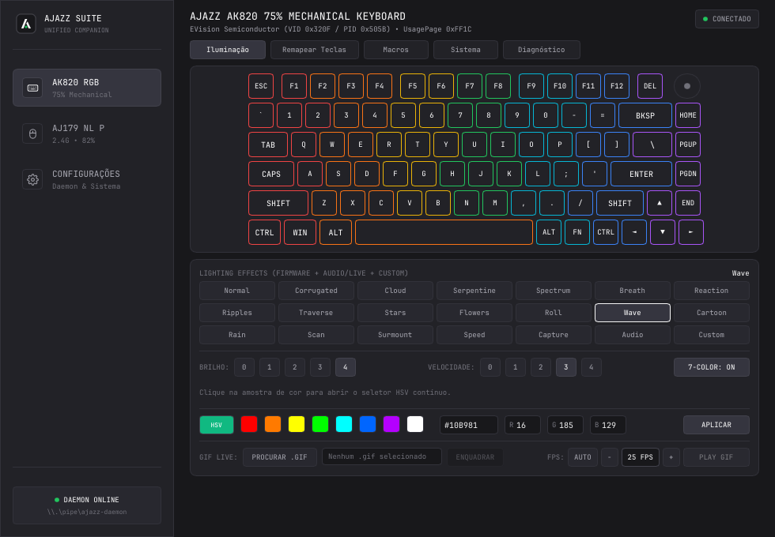
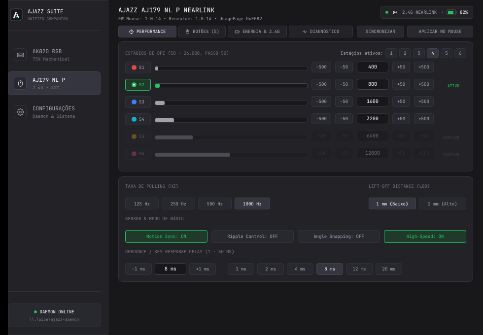
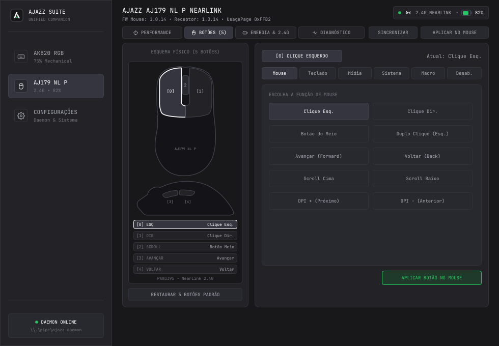
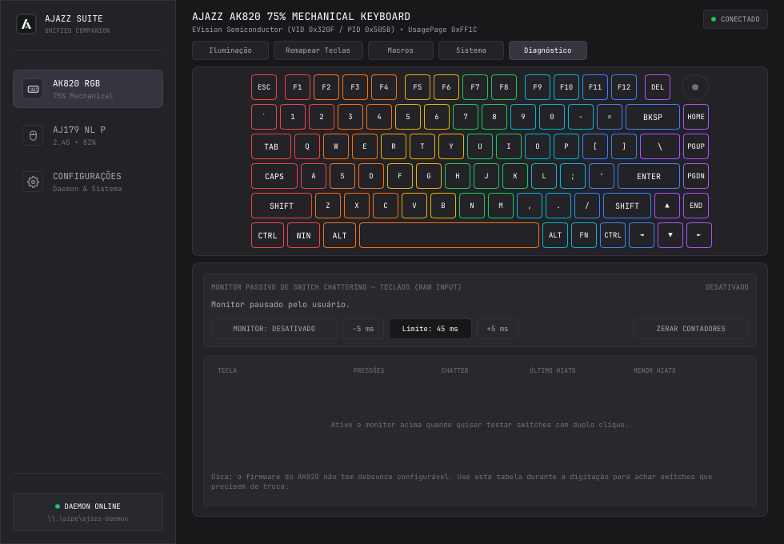

# AJAZZ Companion Suite

Driver open-source em **Rust** + **Slint** para periféricos **AJAZZ**, desenvolvido por engenharia reversa de protocolos USB HID com foco em baixo consumo de recursos, operação via bandeja do sistema (*System Tray*) e proteção contra desgaste da memória Flash dos microcontroladores.



---

## Hardware Suportado

| Dispositivo | Controlador / Interface | USB IDs | Usage Page HID |
| :--- | :--- | :--- | :--- |
| **AJAZZ AK820** (75% ANSI) | EVision Semiconductor | `VID 0x320F` / `PID 0x505B` | `0xFF1C` |
| **AJAZZ AJ179 NL P** (Mouse 2.4G / USB) | NearLink Wireless / Wired | `VID 0x7768` / `PID 0x642E` (2.4G), `0x6D2E` (USB) | `0xFFB2` |

---

## Funcionalidades

### Teclado AJAZZ AK820 (`AK820 RGB`)
- **21 modos de iluminação** configuráveis em hardware e via software (`Normal`, `Corrugated`, `Wave`, `Custom` Per-Key, `Audio`, `Capture`/GIF).
- **Seletor de cor HSV** contínuo, entrada HEX/RGB e controle de brilho, velocidade e direção.
- **GIF Live (25 FPS / Auto)**: reprodução de animações `.gif` diretamente na matriz de LEDs em buffer volátil (RAM), com modal de enquadramento/zoom.
- **Remapeamento completo & Macros**: teclado virtual 75% para remapear teclas (modificadores, mídia, sistema, clique de mouse e macros com gravador de passos).
- **Configurações de sistema**: Win Lock, WASD Swap e Polling Rate do teclado.
- **Diagnóstico passivo de Switch Chattering**: monitor Raw Input opcional (ativado/pausado sob demanda pelo usuário) com limite configurável em milissegundos para identificar switches mecânicos com duplo clique.

### Mouse AJAZZ AJ179 NL P (`AJ179 NL P`)
- **Perfis de DPI**: até 6 estágios configuráveis (`50–26.000 DPI`, passo 50) com sincronização bidirecional.
- **Sensor & Rádio NearLink 2.4G**: Polling Rate (`125–1000 Hz`), Lift-Off Distance (`1 mm` / `2 mm`), `Motion Sync`, `Ripple Control`, `Angle Snapping`, `High-Speed Mode` e Debounce (`1–50 ms`).
- **Remapeamento dos 5 botões** com esquema físico vetorial interativo.
- **Energia & Bateria**: telemetria em tempo real de bateria (`%`), estado de carregamento, Light/Deep Sleep e modo de pareamento 2.4G.
- **Diagnóstico de Switches do Mouse**: monitoramento em tempo real para detectar duplo clique (*chattering*) ou cliques presos.

---

## Capturas de Tela

| Sensor, DPI & Telemetria (AJ179 NL P) | Esquema Vetorial de Botões (AJ179 NL P) |
| :---: | :---: |
|  |  |

| Diagnóstico Passivo de Switches (AK820) |
| :---: |
|  |

---

## Arquitetura do Workspace

O repositório segue separação estrita entre **Daemon**, **GUI** e **Protocolo**:

- `crates/ajazz-protocol` — Tipos de dados puros, serialização/desserialização binária de **HID Reports** e comunicação via `hidapi`, sem dependências de interface gráfica ou IPC.
- `crates/ajazz-daemon` — Serviço headless em segundo plano com ícone na bandeja do Windows (*System Tray*), servidor IPC via Named Pipe (`\\.\pipe\ajazz-daemon`), renderização de GIFs/áudio e monitoramento Raw Input sob demanda.
- `crates/ajazz-gui` — Interface desktop independente construída com **Slint** (`980×680`), que consome memória apenas enquanto aberta e se comunica com o daemon via IPC.
- `crates/ajazz-setup` — Instalador autônomo para Windows (`AjazzSuite-Setup.exe`) com os binários embutidos, instalação por usuário em `%LOCALAPPDATA%\AjazzSuite`, criação do atalho `AJAZZ Suite.lnk` no Menu Iniciar e opção de inicialização automática (`HKCU\Software\Microsoft\Windows\CurrentVersion\Run`).

---

## Segurança de Hardware & Proteção da Flash

1. **Zero Fuzzing / Zero DFU**: apenas comandos e relatórios HID verificados em capturas de tráfego e análise estática são implementados; qualquer rotina de bootloader/DFU/IAP é proibida.
2. **Proteção contra Desgaste da Flash (Flash Wear-Out)**: operações contínuas em alta taxa (como GIF Live a 25 FPS ou visualizador de áudio) escrevem exclusivamente em buffer volátil (RAM), evitando disparar gravações repetidas na memória flash não-volátil do MCU.
3. **Resiliência a Hot-Plug**: desconexões repentinas de cabo USB ou receptor 2.4G são tratadas sem encerrar o daemon ou a interface.

---

## Instalação e Build (Windows)

### Instalador Único (`AjazzSuite-Setup.exe`)

Para compilar a suíte completa e gerar o instalador autônomo em `target\release\AjazzSuite-Setup.exe`:

```powershell
cargo build --release --bins
cargo build --release -p ajazz-setup
```

Ao executar `AjazzSuite-Setup.exe`:
- Instala `ajazz-daemon.exe` e `ajazz-gui.exe` em `%LOCALAPPDATA%\AjazzSuite`;
- Cria o atalho **AJAZZ Suite** no Menu Iniciar;
- Oferece habilitar a inicialização automática do daemon na bandeja junto com o Windows;
- Inicia o daemon automaticamente ao concluir.

### Execução Manual (Desenvolvimento)

```powershell
# Executar o daemon (bandeja do sistema)
cargo run --release -p ajazz-daemon

# Abrir a interface gráfica (em outro terminal)
cargo run --release -p ajazz-gui
```

---

## Testes

```powershell
cargo test --workspace
```

---

## Licença

Distribuído sob a licença **MIT** (veja `Cargo.toml`).
